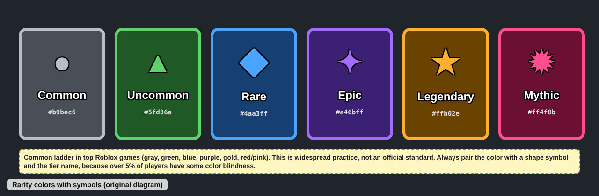
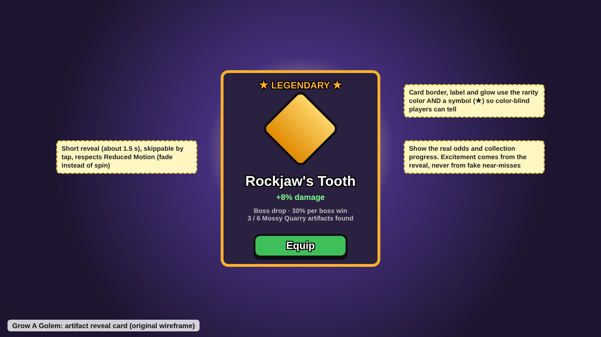

# Art, audio and visual style

Last updated: 2026-10-27. See also [ui-ux.md](ui-ux.md), [performance-mobile.md](performance-mobile.md) and `images/rarity-colors.png`.

## Rules for agents

1. **Readable and bright beats detailed.** Low-poly, flat colors and built-in materials are fine for this genre and cheap on mobile (inference from Grow a Garden's reception; materials cost from [Design for performance](https://create.roblox.com/docs/en-us/performance-optimization/design)).
2. **Rarity colors always come with a symbol or label** for color-blind players ([Accessibility](https://create.roblox.com/docs/en-us/production/publishing/accessibility.md)). Use one shared rarity table in Config; see `images/rarity-colors.png`.
3. **Default rarity ladder** (common practice, unverified): Common gray/white, Uncommon green, Rare blue, Epic purple, Legendary gold/orange, Mythic red/pink; animated/rainbow above that.
4. **Juice is gated on `ReducedMotionEnabled`:** button bounces, pop-ins, camera shake and slides become a snap or fade ([Accessibility](https://create.roblox.com/docs/en-us/production/publishing/accessibility.md)).
5. **Reveal animations show the real roll.** No fake near-miss spins (see [safety-compliance.md](safety-compliance.md)).
6. **Never signal an event by sound alone;** give separate SFX and music volume controls (same Accessibility source).
7. **Only use audio we uploaded or Roblox's licensed library,** and grant our universe permission to each asset, or it plays silent ([Asset privacy](https://create.roblox.com/docs/projects/assets/privacy)).
8. **Thumbnails: 16:9, 1920x1080, 2-5 active,** key art away from the bottom edge, no "50% off" style claims, alt text on each ([Thumbnails](https://create.roblox.com/docs/production/publishing/thumbnails)).
9. **Keep combat cartoon-light:** no blood or gore, to stay Minimal/Mild ([Content maturity](https://create.roblox.com/docs/production/promotion/content-maturity)).

## What top games do

### Style
- **Grow a Garden** uses studded textures recalling old-school Roblox and a classical soundtrack, including public-domain Mozart; Kotaku said it looks more like a prototype ([Wikipedia](https://en.wikipedia.org/wiki/Grow_a_Garden)).
- **Steal a Brainrot** uses voxel meme characters; PC Gamer called its events "sensory overload" ([Wikipedia](https://en.wikipedia.org/wiki/Steal_a_Brainrot)).
- The cartoony simulator UI look is sold as reusable kits (see [visual-references.md](visual-references.md)).
- PS99 tier names (Basic through Celestial) show games use their own rarity names; no per-game color source found ([PS99 wiki](https://pet-simulator.fandom.com/wiki/Ranks_(Pet_Simulator_99))).

### Juice (common practice, unverified)
Button scale-bounce about 1.05-1.1x over 0.1 s; click SFX on every button; pop scale-in for reward cards; floating "+123" numbers; particle burst on rare drops; light camera shake on big hits. No source documents exact parameters.

### Lighting
- `Lighting.Technology`: Voxel (4x4x4 light grid), ShadowMap (crisp sun shadows), Future (most advanced), Compatibility (deprecated; mimic with Voxel plus a Retro ColorGradingEffect). Technology is now superseded by `LightingStyle` and `PrioritizeLightingQuality`. The docs give no performance numbers ([Technology enum](https://create.roblox.com/docs/reference/engine/enums/Technology.md)).
- Voxel or ShadowMap over Future for low-end phones is DevForum consensus, unverified.

### Audio rules
- Since March 22, 2022, user-uploaded audio is private; only Roblox-licensed or creator-owned audio is public ([Pro Game Guides, 2022](https://progameguides.com/roblox/roblox-to-private-millions-of-user-created-sounds-within-its-audio-database/)).
- Audio is Restricted (owner plus granted experiences) or Open Use (irreversible). Grant access in Creator Dashboard: Development Items > Audio > Permissions > Experiences; game-level grants cannot be revoked ([Asset privacy](https://create.roblox.com/docs/projects/assets/privacy)).

### Thumbnails
16:9 at 1920x1080; up to 10 images/videos; personalization images under 3 MB; 3 free video uploads per month, authentic gameplay, no voice-over; personalization needs 2+ (2-5 recommended) and averaged +8.5% qualified play-through lift, up to +50% ([Thumbnails](https://create.roblox.com/docs/production/publishing/thumbnails)).

## Grow A Golem today

- #109: The existing HUD and menus now consume `Icons.create`: XP/minerals/spells, all 13 tabs, the current window header, close, travel guide/locks, quests and event points/reward status. Icons retain adjacent words and zero-ID text fallbacks. No new animation, remote, rarity assignment or purchase behavior is added. Approved sprite uploads still require the owner (#83); broader menu restyles remain separate.

- #83 supplies 37 original mystical UI icons in `assets/ui-icons/`, with editable SVGs, color and grayscale sprite sheets, and a [128/32 px preview](images/ui-icons.png). `Config.UiIcons` holds zero upload IDs and cell coordinates; `Icons.create` provides text fallbacks. Uploads and the shared rarity mapping (#82) remain pending. Existing-screen wiring is complete in #109; full restyles remain in #84–#97. This asset pass changes no UI surface colors or glows; the existing contrast measurements remain applicable.

- Original low-poly templates in `assets/models/Assets.rbxmx` now cover eight golem tiers, six bosses and three prop types. `Build.attachAsset` prefers these under `ReplicatedStorage.Assets`, retains gameplay roots and Motor6D animation, strips imported scripts/physics, and falls back to procedural art when absent. Regular enemies and remaining props use procedural models. Studio appearance remains unverified.
- Server-side lighting setup in `WorldService`; the client blends per-zone color grading and sky haze (`Config.Visuals.zoneTints`, `zoneAtmosphere`, both need `controlLighting`). Technology choice not set in code (check in Studio).
- Six island scenery themes in `Islands.luau` (meadow, ember, crystal, storm, ruins, forge), one per zone, all decoration-only and non-colliding. Part counts for the new three are about half of the meadow island's; not yet measured on a phone.
- Feedback: hit flashes, damage numbers, debris, boss HP bar, artifact reveal card, level-up banner.
- Audio: built-in client sounds (`rbxasset://sounds/...`) re-pitched via `Config.SoundEffects`; `Config.Sounds` moment ids (artifact, levelUp, grow) are 0, so they fall back to the re-pitched effects. 19 original synthesized WAV files are ready for upload in `assets/audio/`, but no valid numeric Roblox IDs or universe permissions have been supplied. No music or volume settings. See `assets/README.md` and [launch/plan.md](../launch/plan.md).
- No shared rarity color table with symbols found; no ReducedMotion gating.
- Two face-first 512px icon alternatives (checked at 48px) and four 1920x1080 thumbnail illustrations (ride, Old Rockjaw's slam, party, growth) now exist in `assets/keyart/` (editable SVG and exported PNG). They are draft illustrations, not gameplay captures or published page assets.
- UI surfaces use five original materials (wood, stone, metal, studs, crystal), drawn in code with optional tiling textures in `assets/ui-textures/`; see [ui-materials.md](ui-materials.md).

## Gaps worth closing

1. **P1:** One rarity table (color + symbol + name) in Config, used by the artifact reveal card, inventory and Shop (`images/rarity-colors.png`).
2. **P1:** ReducedMotion gating for shake, pop and slide effects.
3. **P1 (#16):** Upload original SFX for the three big moments and a looping music track; grant universe permissions; add SFX/music volume sliders.
4. **P1 (#16):** 3-5 bright, golem-forward thumbnails at 1920x1080 plus an icon; rotate per update.
5. **P2 (#16):** Per-tier forge visuals (material and color per tier) so power is visible.
6. **P2:** Pick Voxel or ShadowMap after measuring on a low-end phone (#9).

## Sources

All accessed 2026-10.
- Wikipedia, Grow a Garden: https://en.wikipedia.org/wiki/Grow_a_Garden
- Wikipedia, Steal a Brainrot: https://en.wikipedia.org/wiki/Steal_a_Brainrot
- Pet Simulator Wiki, Ranks (PS99): https://pet-simulator.fandom.com/wiki/Ranks_(Pet_Simulator_99)
- Roblox Creator Docs, Accessibility: https://create.roblox.com/docs/en-us/production/publishing/accessibility.md
- Roblox Creator Docs, Technology enum: https://create.roblox.com/docs/reference/engine/enums/Technology.md
- Roblox Creator Docs, Asset privacy: https://create.roblox.com/docs/projects/assets/privacy
- Roblox Creator Docs, Thumbnails: https://create.roblox.com/docs/production/publishing/thumbnails
- Roblox Creator Docs, Content maturity: https://create.roblox.com/docs/production/promotion/content-maturity
- Roblox Creator Docs, Design for performance: https://create.roblox.com/docs/en-us/performance-optimization/design
- Pro Game Guides, 2022 audio privacy change: https://progameguides.com/roblox/roblox-to-private-millions-of-user-created-sounds-within-its-audio-database/
- DevForum, audio privacy announcement (returned empty when fetched): https://devforum.roblox.com/t/1701697
