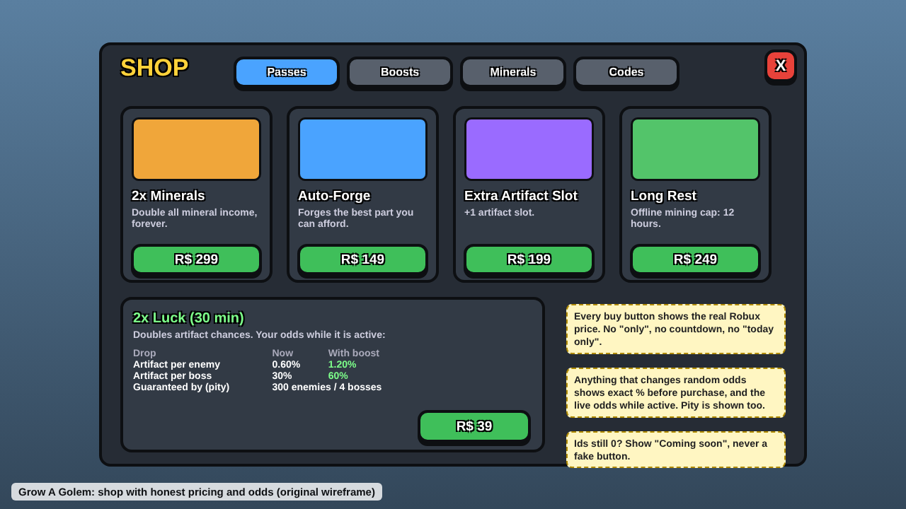

# Monetization

Last updated: 2026-10-27. Read [safety-compliance.md](safety-compliance.md) first; it overrides this doc. Prices in Robux (R$), as of the source dates.

## Rules for agents

1. **Every purchase button shows its Robux price** and opens a confirm step. Debounce taps so one press can never buy twice (house rule, after [FTC v. Epic](https://www.ftc.gov/node/80648)).
2. **Show real odds before any paid random item, including 2x Luck,** and update displayed odds live while a boost is active ([Paid random items](https://create.roblox.com/docs/production/monetization/paid-random-items)).
3. **Check `PolicyService` on the server** before showing 2x Luck; if `ArePaidRandomItemsRestricted`, hide or block it. Check `IsPaidItemTradingAllowed` before any trade (same source).
4. **Cosmetics and pets: direct purchase only.** No paid eggs, crates or spins for cosmetics (house rule, #14).
5. **No countdown timers on purchases, no "today only" Robux offers, no "only/just X Robux" wording,** no copy urging kids to buy ([Advertising Standards](https://en.help.roblox.com/hc/en-us/articles/13722260778260-Advertising-Standards); [Monetization](https://create.roblox.com/docs/en-us/production/monetization.md)).
6. **Sell time-savers, capacity and cosmetics, not paid power over other players.** No pay-to-grief items (paid fling/steal gear) (inference from patterns below).
7. **Never paywall core progression.** Every zone, boss and artifact must be reachable free.
8. **No shop pop-ups on login or right after a loss**; cap auto-opened shop prompts (house rule, inference).
9. **Rewarded ads only for 13+ with fixed rewards**, never a random roll ([Advertising Standards](https://en.help.roblox.com/hc/en-us/articles/13722260778260-Advertising-Standards)). Not a core revenue line for this audience.
10. **Use real pass/product ids from Config;** a purchase path with id 0 must be hidden, not broken.

## What top games do

### Pass ladders and price points
- **Pet Simulator 99:** Auto Farm R$175, Lucky! R$275, Auto Tap R$350, +15 Pets R$375, VIP R$400 (VIP area, 6-hour reward chest), +15 Eggs R$625, Ultra Lucky! R$800, up to Huge Hunter R$3,250 for a still non-guaranteed chance ([PS99 wiki](https://pet-simulator.fandom.com/wiki/Gamepasses_(Pet_Simulator_99))).
- **Blox Fruits:** Fast Boats R$350, 2x Boss Drop R$350, +1 Fruit Storage R$400 (stackable), 2x Money R$450, 2x Mastery R$450, Dark Blade R$1,200, Fruit Notifier R$2,700; all passes about R$5,500 total. Fragment packs R$75-1,499 ([Blox Fruits wiki](https://blox-fruits.fandom.com/wiki/Shop)).
- **Steal a Brainrot:** 2X Money R$199, VIP R$199, HD Admin R$1,999; paid gear up to R$1,499, some of which flings other players ([Deltia's Gaming](https://deltiasgaming.com/roblox-steal-a-brainrot-all-gear-and-game-passes)).
- **Grow a Garden:** Season 1 Pass premium track R$749 over a free track, 50 levels; skip one level R$49, skip all R$1,699; products R$79-375 ([Sportskeeda](https://www.sportskeeda.com/roblox-news/grow-garden-season-1-pass-all-tier-rewards-premium-price)). Eggs are loot-box style and the co-owner was criticized for excessive monetization ([Wikipedia](https://en.wikipedia.org/wiki/Grow_a_Garden)).
- **Adopt Me Pets Plus** subscription: $2.99/month; VIP rooms, a second equipped pet, a streak that survives a few missed days ([Sportskeeda](https://www.sportskeeda.com/roblox-news/adopt-me-pets-plus-subscription-benefits-content-price)).
- Pattern (inference): 5-15 passes; entry R$175-275, core R$350-450 (2x currency, VIP, slots), mid R$600-800, one or two whale passes R$1,200-3,250. Standard pass types: 2x currency, auto-farm, VIP, extra slots, luck, speed.

### Platform programs (official)
- **Game passes** are one-time; **developer products** are repeatable. Also: paid access, private servers, immersive ads, managed/regional pricing ([Monetization](https://create.roblox.com/docs/en-us/production/monetization.md)).
- **Subscriptions:** $2.99-14.99 tiers or R$49+; local-currency pays 70% month 1 then 100%; benefits must be honored for the full term; Robux reprice once per 60 days ([Subscriptions](https://create.roblox.com/docs/en-us/production/monetization/subscriptions.md)).
- **Creator Rewards** (from July 24, 2025): R$5 per active spender who plays 10+ minutes as one of their first 3 games that day; 35% of a new/returning user's first $100 of spend over 60 days ([Creator Rewards](https://create.roblox.com/docs/creator-rewards.md)). Implication: long sessions and returning players earn money directly.
- **Rewarded video ads:** 13+ only, 6-30 s, opt-in; launch required 100K+ DAU ([DevForum](https://devforum.roblox.com/t/more-creators-can-now-use-rewarded-video-ads/3838678)).
- **Private servers:** free or monthly Robux; changing price cancels subscriptions ([Private servers](https://create.roblox.com/docs/en-us/production/monetization/private-servers.md)).
- **DevEx:** $0.0038/Robux since Sept 5, 2025; R$30,000 minimum; $0.0054 for age-checked US 18+ spend in eligible games ([DevEx](https://create.roblox.com/docs/de-de/production/monetization/developer-exchange); [Roblox newsroom Apr 2026](https://about.roblox.com/newsroom/2026/04/roblox-fuels-high-fidelity-games-over-18-players-increases-qualifying-devex-rate-42)).
- Q2 2026: Roblox said per-hour monetization of younger US/Canada users fell as play moved away from 2025 viral games ([Q2 2026 letter](https://www.sec.gov/Archives/edgar/data/0001315098/000162828026051059/ex991-robloxq22026earnin.htm)).

### Patterns we do not copy
Paid luck stacking to a non-guaranteed chase (PS99 Huge Hunter), paid griefing gear (Steal a Brainrot), loot-box pets and crop stealing for Robux (Grow a Garden), and R$1,699 season skips ([sources above](#pass-ladders-and-price-points)).

## Grow A Golem today

| Item | Type | Price | Norm comparison |
|---|---|---|---|
| Auto-Forge | Pass | R$149 | Entry tier, below PS99 Auto Farm R$175 |
| Extra Artifact Slot | Pass | R$199 | Capacity pass; cheap vs R$375-400 norms |
| Long Rest (12h offline) | Pass | R$249 | Idle time-saver |
| 2x Minerals | Pass | R$299 | In 2x-currency band (R$199-450) |
| VIP (nametag, +10% XP) | Pass | R$399 | Matches PS99 VIP R$400 |
| Mineral packs | Product | R$49/149/449 | Normal currency-pack spread |
| 2x XP 30 min | Product | R$39 | Fixed effect, low risk |
| 2x Luck 30 min | Product | R$39 | **Paid probability modifier**: full rules apply |

- All pass and product ids are 0 (not created). No subscriptions, no ads, no written Creator Rewards strategy.
- 2x Luck is gated by `PolicyService` (hidden where paid random items are restricted, fail closed) and the Shop shows the player's real odds now and with the boost, live while it's active (#26).
- No whale pass and no paid power over other players. Good fit for 9-15.

## Gaps worth closing

1. ~~**P0:** PolicyService gate and live odds for 2x Luck (see safety doc).~~ Done in #26.
2. **P0 (#9):** Create real ids, hide items with id 0, and audit all shop copy for price display, confirm step, and banned wording.
3. **P1 (#14):** Direct-purchase cosmetics (golem skins, trails, nametag colors) as the main growth line; no random cosmetic boxes.
4. **P1:** Write a Creator Rewards note: target 10+ minute sessions and returning spenders; measure with #11 analytics.
5. **P2:** Optional free season track with an optional premium track, no level-skip upsells (inference).
6. **P2:** Free private servers as a goodwill win (inference).
7. **Later:** a Robux subscription only if benefits can be honored for a full term; rewarded ads only after 13+ gating is built.

## Sources

All accessed 2026-10.
- Pet Simulator Wiki, Gamepasses (PS99): https://pet-simulator.fandom.com/wiki/Gamepasses_(Pet_Simulator_99)
- Blox Fruits Wiki, Shop: https://blox-fruits.fandom.com/wiki/Shop
- Deltia's Gaming, Steal a Brainrot gear and passes: https://deltiasgaming.com/roblox-steal-a-brainrot-all-gear-and-game-passes
- Sportskeeda, Grow a Garden Season 1 Pass: https://www.sportskeeda.com/roblox-news/grow-garden-season-1-pass-all-tier-rewards-premium-price
- Sportskeeda, Adopt Me Pets Plus: https://www.sportskeeda.com/roblox-news/adopt-me-pets-plus-subscription-benefits-content-price
- Wikipedia, Grow a Garden: https://en.wikipedia.org/wiki/Grow_a_Garden
- Roblox Creator Docs, Monetization: https://create.roblox.com/docs/en-us/production/monetization.md
- Roblox Creator Docs, Subscriptions: https://create.roblox.com/docs/en-us/production/monetization/subscriptions.md
- Roblox Creator Docs, Creator Rewards: https://create.roblox.com/docs/creator-rewards.md
- Roblox Creator Docs, Private servers: https://create.roblox.com/docs/en-us/production/monetization/private-servers.md
- Roblox Creator Docs, Developer Exchange: https://create.roblox.com/docs/de-de/production/monetization/developer-exchange
- Roblox Creator Docs, Paid random items: https://create.roblox.com/docs/production/monetization/paid-random-items
- DevForum, rewarded video ads expansion: https://devforum.roblox.com/t/more-creators-can-now-use-rewarded-video-ads/3838678
- Roblox newsroom, video ads (Apr 2025): https://about.roblox.com/newsroom/2025/04/roblox-scales-video-ads-partners-with-google
- Roblox newsroom, 18+ DevEx rate (Apr 2026): https://about.roblox.com/newsroom/2026/04/roblox-fuels-high-fidelity-games-over-18-players-increases-qualifying-devex-rate-42
- Roblox Q2 2026 shareholder letter: https://www.sec.gov/Archives/edgar/data/0001315098/000162828026051059/ex991-robloxq22026earnin.htm
- Roblox Help, Advertising Standards: https://en.help.roblox.com/hc/en-us/articles/13722260778260-Advertising-Standards
- FTC, Epic settlement: https://www.ftc.gov/node/80648
