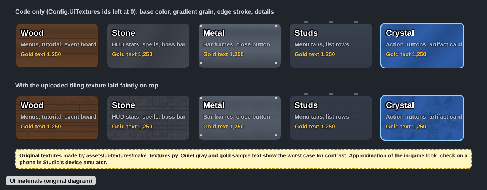

# UI textures and materials

Last updated: 2026-10-28. See also [ui-ux.md](ui-ux.md), [art-audio.md](art-audio.md) and [performance-mobile.md](performance-mobile.md).

## Rules for agents

1. **Every panel, button, bar and row gets a material through `Ui.surface(target, material, options)`** in `src/client/Ui.luau`. Don't hand-set `BackgroundColor3` plus a one-off `UIStroke`/`UIGradient` on a new surface; pick a material, and use `options.tint` for a variant (disabled, gold card).
2. **Match the material to the job,** so the same thing always looks the same:
   | Material | Use it for | Feel |
   |---|---|---|
   | plate | Menu windows, dialogs, the HUD stats slab and goal card | Dark night-blue brick, "a place to read" |
   | gem | Header bars and every kit button (always tinted with a style or header color) | Chunky glossy plastic, "press me" |
   | studs | List rows, cards, summaries, empty states | Classic Roblox brick, "things you pick" |
   | wood | The tutorial sign, the event notice board | Workshop, "a message for you" |
   | stone | Spell runestones, the code box | Solid, golem body |
   | metal | Bar frames (health, XP, goal, boss, progress) | Iron fittings |
   | crystal | The artifact reveal card | Rune magic |
   Bar fills use `Ui.fill(frame, color)` (a glossy top and darker base), not a material.
3. **Text contrast is checked against the brightest point of the surface (its base color).** Textures and grain only darken it. Body text needs at least 4.5:1 and large text 3:1 ([WCAG 2.1, 1.4.3](https://www.w3.org/TR/WCAG21/#contrast-minimum)). If you add a material or change a base color, re-run the numbers (table below) and keep white text at 4.5:1 or better.
4. **On metal, crystal, gem buttons and header bars, use white text only.** Quiet gray, gold and rune blue fall under 4.5:1 there.
5. **Every label keeps its thick dark outline**: `Ui.label` adds a `UIStroke` named `Outline` in `Contextual` mode (2 px, 3 px from 24 px up). It is what keeps text readable over grain on small phone screens. Dark text on cream (the speech bubble, key caps) is the one place without it.
13. **Buttons come from `Ui.button(..., style)`**, never hand-tinted: `primary` (green, the main action), `secondary` (gray), `robux` (gold-orange, always the Robux icon and price), `danger` (red: close, cancel, leave), and disabled (dull gray, quiet text). Every kit button is at least 48 x 48 px. The old all-blue crystal button is retired.
14. **Header colors come from `Ui.Headers`**, one per menu: orange Forge, teal Travel, purple Artifacts, blue Skills/Party/Hub/Trade, amethyst Awaken, green Quests, gold Events/Ranks, lilac Shop/Wardrobe.
15. **Rarity colors come from `Config.Rarities`** (via `Ui.rarity`), with the symbol icon and the name always beside the color.
6. **A UIGradient on a TextLabel or TextButton also tints its text** (Roblox lists text objects among what a gradient applies to; it never reaches child objects) ([UIGradient](https://create.roblox.com/docs/reference/engine/classes/UIGradient.md)). So `Ui.surface` clamps grain on text objects to 82% or brighter and never lays an image over them. Put heavy texture on a Frame behind the text instead.
7. **Keep each grain to 6 color stops or fewer,** as Roblox advises for UIGradient ([UIGradient](https://create.roblox.com/docs/reference/engine/classes/UIGradient.md)).
8. **Code-drawn details (`details = true`: plank seams, rivets, studs, bevel line) go only on frames built once.** List rows rebuild every second on some tabs, so they get grain and edge only (performance, see [performance-mobile.md](performance-mobile.md)).
9. **Textures must be original or clearly licensed.** Ours are generated by `assets/ui-textures/make_textures.py` from seeded noise. Never pull textures from other games, Google Images, or Creator Store items without a license that allows it.
10. **Every image texture has a code fallback.** Ids in `Config.UiTextures` stay `0` until Jackson uploads the file; at `0` the surface still has its color, grain, edge and details.
11. **Texture images are grayscale, tile seamlessly, and are tinted in game** with `ImageColor3` (white means no tint) and drawn with `ScaleType.Tile` and a pixel `TileSize` ([ImageLabel](https://create.roblox.com/docs/reference/engine/classes/ImageLabel.md)). One grayscale file then serves every tint.
12. Images pass Roblox moderation after upload, and players don't see one until it's approved ([Assets](https://create.roblox.com/docs/en-us/projects/assets)). Check each texture shows in a published test before relying on it.

## What top games do

- Grow a Garden uses studded textures that recall old-school Roblox ([Wikipedia](https://en.wikipedia.org/wiki/Grow_a_Garden)). Studs read as "Roblox" to players, which is why we use them on the tabs and rows players pick from.
- Cartoony simulator UIs (see [ui-ux.md](ui-ux.md#what-top-games-do)) favor thick dark outlines, rounded corners and saturated gradients over detailed photo textures (common practice, unverified). Our materials follow that: low-contrast grain, a strong edge, bold outlined text.
- Roblox offers three ways to texture UI: a UIGradient on any GuiObject, a UIStroke edge, and images that can stretch, tile or 9-slice (`ScaleType.Slice` with `SliceCenter` keeps corners crisp while the middle stretches) ([UI appearance modifiers](https://create.roblox.com/docs/ui/appearance-modifiers); [ImageLabel](https://create.roblox.com/docs/reference/engine/classes/ImageLabel.md)). We use tiling, because 9-slice frames need a separate image per border style.

## Grow A Golem today

- **#82 menu kit (2026-10-28).** `src/client/Ui.luau` now builds every screen from shared pieces: `Ui.window` (plate body, gem header bar with icon, 30 px title, red 48 px X), `Ui.button` styles, `Ui.item` rows that grow to fit their text, `Ui.card` (rarity cards, 180 x 252), `Ui.progress` ("N TO GO" bars), `Ui.checklist`, `Ui.empty`, `Ui.dialog` (portrait, name tag, cream speech bubble), `Ui.summary`, `Ui.chip`, `Ui.badge`, `Ui.toggles`, `Ui.grid` and `Ui.short` (1.2K, 3.4M). Text uses Builder Sans ExtraBold for titles and buttons and Builder Sans Bold for body text, at fixed sizes (body 18, headings 28, titles 30) instead of `TextScaled`. `Ui.surface` scales panel transparency by `GuiService.PreferredTransparency`, and `Ui.tween` snaps when `ReducedMotionEnabled` is on. See [the kit wireframe](images/menu-kit.png).
- **#175 lips and plates.** `Ui.surface(..., "gem")` now adds a `Lip` frame (the tint mixed 50% toward black, 14% of the height) under every kit button and header, and the plate edge is 5 px. The HUD stats readout has no plate any more (text with outlines only); the goal card, event board and runestones keep theirs.
- Where each material is used: menu windows, dialogs, the stats slab and the goal card (plate, studs on frames built once), header bars and buttons (gem), rows, cards, summaries and empty states (studs), bars (metal with gloss fills), the tutorial sign and event board (wood), spell runestones and the code box (stone), the artifact reveal card (crystal tinted with its rarity).
- #109 and #83: the menus and HUD use `Icons.create` for tabs, minerals, spells, rarity symbols, status and the guide portrait, with word labels beside them and text fallbacks while `Config.UiIcons` ids are 0.
- Textures: `assets/ui-textures/{wood,stone,metal,studs,crystal}.png`, 256x256 grayscale, seamless, 45-100% brightness. Plate reuses the studs texture and gem reuses the crystal texture, tinted. `Config.UiTextures` ids are all `0`, so the game shows the code-only look until they're uploaded.
- Measured contrast at each base color (the worst case; grain and textures only darken):

  | Surface | White text | Quiet gray (196,202,214) | Gold (255,214,90) | Dimmed step (166,172,186) |
  |---|---|---|---|---|
  | plate (30,34,50) | 15.8 | 9.6 | 11.3 | 6.9 |
  | row (46,54,74) | 12.1 | 7.3 | 8.6 | 5.3 |
  | card (40,46,64) | 13.5 | 8.2 | 9.7 | 5.9 |
  | primary green (28,126,54) | 5.1 | - | - | - |
  | secondary gray (84,92,110) | 6.7 | 4.1 | - | - |
  | robux gold-orange (170,90,0) | 5.0 | - | - | - |
  | danger red (196,48,52) | 5.5 | - | - | - |
  | disabled (66,70,80) | 9.4 | 5.7 | - | - |
  | header orange (172,84,16) | 5.2 | - | - | - |
  | header teal (14,118,120) | 5.4 | - | - | - |
  | header purple (116,64,190) | 6.5 | - | - | - |
  | header blue (40,96,184) | 6.1 | - | - | - |
  | header amethyst (96,60,160) | 7.9 | - | - | - |
  | header green (32,124,58) | 5.2 | - | - | - |
  | header gold (146,100,0) | 5.2 | - | - | - |
  | header lilac (132,84,176) | 5.4 | - | - | - |
  | rarity cards (darkest to lightest: common 74,79,87 to rare 22,63,115) | 8.2 to 12.8 | - | - | - |
  | wood (96,64,42) | 8.1 | 5.1 | 5.4 | - |
  | stone (66,70,78) | 8.3 | 5.2 | 5.5 | - |

  Dark text (40,32,24) on the cream speech bubble (255,244,214) measures 14.6.

## Uploading the textures (Jackson)

These steps are from memory of Studio's menus, not a cited source; the labels may differ slightly.

1. In Studio, open **Asset Manager** (View → Asset Manager) → **Bulk Import**, and pick the five PNGs in `assets/ui-textures/`.
2. Right-click each imported image → **Copy ID to Clipboard**, and paste the number into the matching field of `Config.UiTextures` in `src/shared/Config.luau`.
3. Play-test: panels should show planks, bricks, brushed metal, studs and facets faintly under the text. If one looks too strong or weak, change that material's `imageTransparency` in `Ui.Materials`.
4. To change a texture, edit `make_textures.py`, run `python3 assets/ui-textures/make_textures.py`, and upload the new file.

## Gaps worth closing

1. **Done (#82):** `Ui.surface` multiplies panel transparency by `GuiService.PreferredTransparency`. It reads the setting when a surface is built, so a change takes effect when a menu next refreshes.
2. **P1:** Check the look on a low-end phone in a published test (#9): grain, edge and detail frames are cheap, but count draw calls if many rows are open.
3. **P2 (#16):** Studio-designed 9-slice frames (carved stone border, wooden sign edge) if the art pass wants hand-made borders.
4. **P2:** Per-zone tints (meadow green wood, ember red stone, crystal blue metal) using `options.tint`.

## Sources

All accessed 2026-10.
- Roblox Creator Docs, UIGradient: https://create.roblox.com/docs/reference/engine/classes/UIGradient.md
- Roblox Creator Docs, ImageLabel: https://create.roblox.com/docs/reference/engine/classes/ImageLabel.md
- Roblox Creator Docs, UI appearance modifiers: https://create.roblox.com/docs/ui/appearance-modifiers
- Roblox Creator Docs, Assets: https://create.roblox.com/docs/en-us/projects/assets
- W3C, WCAG 2.1 Contrast (Minimum): https://www.w3.org/TR/WCAG21/#contrast-minimum
- Wikipedia, Grow a Garden: https://en.wikipedia.org/wiki/Grow_a_Garden
