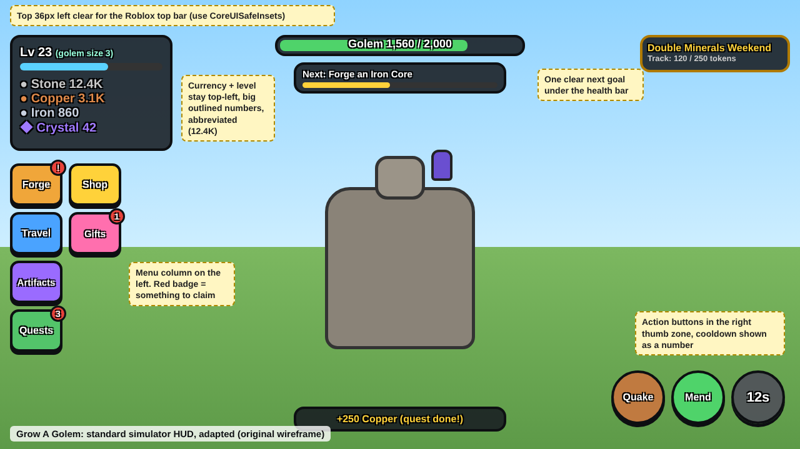
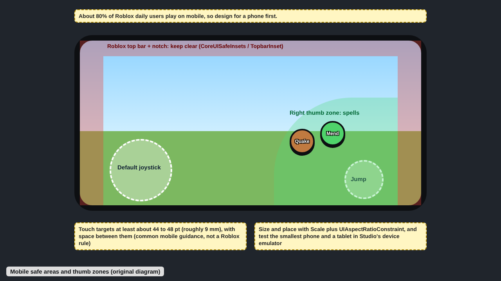

# UI/UX

Last updated: 2026-10-28. See also [ui-materials.md](ui-materials.md) (surface textures), [performance-mobile.md](performance-mobile.md), [art-audio.md](art-audio.md) and the wireframes in [visual-references.md](visual-references.md#our-wireframes).

## Rules for agents

1. **Set `ScreenGui.ScreenInsets = Enum.ScreenInsets.CoreUISafeInsets` on every ScreenGui with buttons or important info.** Use `None` only for non-interactive backgrounds ([ScreenInsets](https://create.roblox.com/docs/reference/engine/enums/ScreenInsets.md)).
2. **Position and size with Scale,** add `UIAspectRatioConstraint` to square buttons and icons, and cap size on big screens with `UISizeConstraint`/`UIScale` (inference from [Position and size](https://create.roblox.com/docs/en-us/ui/position-and-size.md)).
3. **Keep the default mobile joystick (bottom-left) and jump button (bottom-right) clear.** Place custom touch buttons relative to the jump button, in thumb reach of the bottom corners ([Cross-platform design](https://create.roblox.com/docs/ui/cross-platform-design)).
4. **Do not use `TextScaled` for body text;** it ignores the player's `GuiService.PreferredTextSize`. Use fixed TextSize with `TextWrapped` and `AutomaticSize`, clamped by `UITextSizeConstraint` where needed ([Accessibility](https://create.roblox.com/docs/en-us/production/publishing/accessibility.md)).
5. **Respect `GuiService.ReducedMotionEnabled`:** replace slides, bounces and shakes with an instant snap or fade (same source).
6. **Multiply panel `BackgroundTransparency` by `GuiService.PreferredTransparency`** (same source).
7. **Never signal by color alone.** Rarity and status carry a symbol or label too (over 5% of people have some color blindness, same source).
8. **Every action works with touch, mouse/keyboard and gamepad;** prompts change with the active input ("Press A", tap, Q) ([Adaptive design](https://create.roblox.com/docs/production/publishing/adaptive-design.md)).
9. **Show only vital info during play;** move secondary buttons into a collapsible menu on small screens; prefer ProximityPrompts for context actions ([Cross-platform design](https://create.roblox.com/docs/ui/cross-platform-design); [Adaptive design](https://create.roblox.com/docs/production/publishing/adaptive-design.md)).
10. **Abbreviate large numbers** with one shared helper (1.2K, 3.4M, 5.6B, T...) (common practice, unverified).
11. **Every purchase button shows its Robux price** (see [safety-compliance.md](safety-compliance.md)).
12. Touch targets: aim for at least about 44-48 px (Apple/Google HIG figure quoted on DevForum; no Roblox source, unverified).

## Writing for kids

Our players are 9 to 15. Every word on screen follows these rules (house style, from the #82 brief; not from a cited source).

1. **One idea per sentence, about 12 words or fewer.** "Beat Old Rockjaw to open Ember Flats." Not a sentence with directions in it.
2. **Everyday words.** Taught game words stay ("Forge", "Awaken", "artifact"); everything else is a word a 9-year-old uses: "beat" not "defeat", "sure to drop" not "guaranteed".
3. **Say what to do next.** A locked thing says how to open it; an empty list says what's missing and what to do ("No artifacts yet. Beat monsters to find your first one!").
4. **Numbers over words.** "12 TO GO" on a bar, "3 days left", "Rank 2 / 5".
5. **No pressure near anything paid.** No "only", "just", "hurry", "limited", "today only" or timers next to a Robux button (see [safety-compliance.md](safety-compliance.md)). Gameplay timers (gifts, events) never sit beside a price.
6. **Friendly, not spooky.** Exclamation marks for good news, plain calm words for resets and warnings.

## What top games do

### HUD layout (convention, mostly unverified)
No primary source documents exact HUD placement for any named game. The following is common practice seen in PS99, Bee Swarm, Blox Fruits and Adopt Me (unverified):
- Currency counters stacked at left-center/bottom-left or top-center.
- A vertical column of square icon buttons (Shop, Inventory, Rebirth, Quests, Settings) on the left edge near vertical middle.
- A red badge with a number or "!" on buttons with unclaimed rewards.
- Heavy rounded fonts with a thick dark `UIStroke` outline; rounded panels (`UICorner`), saturated gradients, drop shadows.

Sourced points:
- PS99 shows a quests panel at the side of the screen, and each rank has a reward path ([PS99 wiki: Ranks](https://pet-simulator.fandom.com/wiki/Ranks_(Pet_Simulator_99))).
- The "Grow a Garden style" and "cartoony simulator" look is sold as ready-made UI kits, which shows it is a reusable template (see [visual-references.md](visual-references.md)).
- Grow a Garden was called prototype-like by Kotaku and still hit about 22M CCU, which suggests a clear loop beats polish ([Wikipedia](https://en.wikipedia.org/wiki/Grow_a_Garden)).

### Roblox official guidance
- **ScreenInsets:** `None` (under notches), `DeviceSafeInsets` (avoids cutouts only), `CoreUISafeInsets` (also avoids Roblox core UI; recommended), `TopbarSafeInsets` (read `GuiService.TopbarInset`) ([ScreenInsets](https://create.roblox.com/docs/reference/engine/enums/ScreenInsets.md)).
- **Reach varies by device:** a button 40% down the screen is reachable on a phone, awkward on a tablet ([Cross-platform design](https://create.roblox.com/docs/ui/cross-platform-design)).
- **Adaptive:** gamepad-focusable controls, portrait and landscape if allowed, collapse panels on narrow screens, avoid thin or decorative fonts, enough contrast for changing lighting (no ratio given), test on real devices ([Adaptive design](https://create.roblox.com/docs/production/publishing/adaptive-design.md)).
- **Accessibility:** PreferredTextSize (Medium default up to Largest), PreferredTransparency, ReducedMotionEnabled; don't signal by sound alone; separate volume for SFX, music, speech ([Accessibility](https://create.roblox.com/docs/en-us/production/publishing/accessibility.md)).
- Community guide (not official): breakpoints at about 600 px (mobile) and 1200 px (tablet), `GetGuiInset()` plus 10 px padding ([playbooks.com](https://playbooks.com/skills/taozhuo/game-dev-skills/ui-ux)).

## Grow A Golem today

- **Menu kit (#82, 2026-10-28).** Every menu, the HUD, the tutorial and the big moments are built from the kit in `src/client/Ui.luau` (see [ui-materials.md](ui-materials.md) and [the wireframe](images/menu-kit.png)). Text is Builder Sans at fixed sizes with a thick `UIStroke` outline, so `PreferredTextSize` applies; rows and cards grow with `AutomaticSize`. `TextScaled` remains only on floating damage numbers.
- **Window and tabs (#84).** A colored header per tab with its icon and title, and a red 48 px X. Escape and gamepad B close the newest dialog, then the menu grid, then the window. The tab column holds 176 x 56 buttons with icon and label; a red "!" badge shows on Quests, Events and Artifacts exactly when something is ready. Under 900 x 520 px the column folds into one Menu button that opens the tabs as a grid, and the window narrows to 60% of the width to leave the thumb corners clear.
- **HUD (#85).** The stats slab shows minerals in two columns as icon and short number (`Ui.short`). The goal card sits top right: a GOAL header, one short sentence, up to three checklist steps and a "to go" bar; tapping it opens the menu it points to, and it steps aside when the boss bar would overlap it. Event banner time reads "3 days left".
- **Menus (#86 to #95).** Forge rows show the real stat gain, tier chips, a bar for the missing mineral and a set-bonus line. Travel gives each island a color stripe and chips; a locked island opens a guide dialog with a bar to its gate. Artifacts, Skills, Events and Wardrobe use rarity or item cards in grids, with sort or filter toggles. Quests show the 7 day boxes, gifts and quests with bars, ready ones first. Awaken and Ascend confirm in a plain-words dialog. Trade shows "You give" and "You get" side by side when the window is wide enough, with one footer button. Ranks color the top three and always show your own row.
- **Moments (#96, #97).** The tutorial sign shows "STEP N OF M" with a bar, a key cap for the input (Q, WASD, Tap, X) and a 48 px Skip button. The artifact reveal uses the rarity table's color, symbol and name, with Nice! and Equip buttons. The boss bar has a red name plate and the numbers inside the bar.
- Still missing: gamepad focus order beyond the confirm button in dialogs, and a Studio check at Largest text size on a small phone (#9).

## Gaps worth closing

1. **P0 (#9):** Set `CoreUISafeInsets` on all interactive ScreenGuis; verify on a notched phone that spell buttons do not overlap the jump button (`images/mobile-safe-areas.png`).
2. **Done (#82):** `Ui.short` formats minerals, costs, health and boss numbers. Damage numbers in `Fx.luau` still show raw values.
3. **Done (#82):** Fixed text sizes replace `TextScaled` on all menu and HUD text. Check at Largest text size in Studio (#9).
4. **Mostly done (#82):** Kit tweens, the tutorial bob and the reveal glow respect `ReducedMotionEnabled`. Camera shake in `Fx.luau` does not yet.
5. **Done (#84):** Red "!" badges on Quests, Events and Artifacts.
6. **Done (#84):** The left column folds into a Menu button on small screens.
7. **Done (#82 to #97):** Cartoony restyle with a heavier outlined font and brighter palette. Playtest it (#9).
8. **P2:** Gamepad focus order and input-aware prompts.

## Sources

All accessed 2026-10.
- Roblox Creator Docs, ScreenInsets: https://create.roblox.com/docs/reference/engine/enums/ScreenInsets.md
- Roblox Creator Docs, Position and size: https://create.roblox.com/docs/en-us/ui/position-and-size.md
- Roblox Creator Docs, Cross-platform design: https://create.roblox.com/docs/ui/cross-platform-design
- Roblox Creator Docs, Adaptive design: https://create.roblox.com/docs/production/publishing/adaptive-design.md
- Roblox Creator Docs, Accessibility: https://create.roblox.com/docs/en-us/production/publishing/accessibility.md
- Pet Simulator Wiki, Ranks (PS99): https://pet-simulator.fandom.com/wiki/Ranks_(Pet_Simulator_99)
- Wikipedia, Grow a Garden: https://en.wikipedia.org/wiki/Grow_a_Garden
- playbooks.com, game-dev-skills ui-ux (community): https://playbooks.com/skills/taozhuo/game-dev-skills/ui-ux
